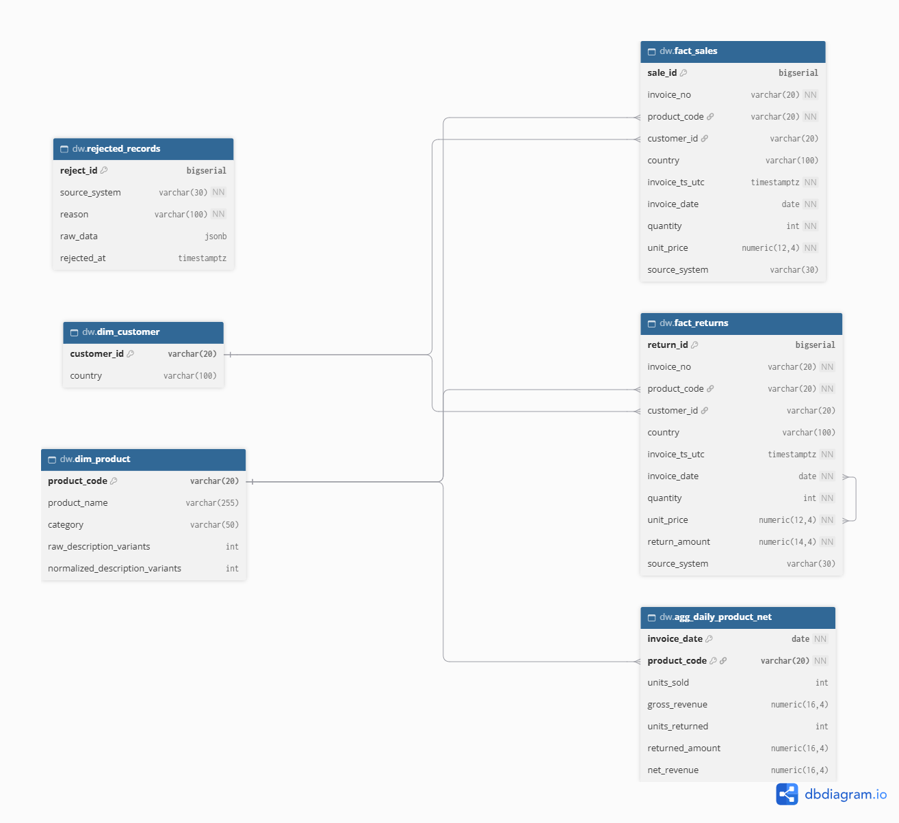

# DataMart S.A.S. – Pipeline ETL con Apache Airflow

Pipeline ETL de extremo a extremo: ingesta dos CSV de transacciones, aplica
reglas de calidad y de negocio, y carga un repositorio analítico en PostgreSQL.
Todo corre en Docker con un solo comando.

## Requisitos
- Docker Desktop (o Docker Engine + Compose v2) y Git.
- Puertos libres: 8080 (Airflow) y 5433 (DW).

## Puesta en marcha (≈ 10 minutos)

### 1. Clonar y configurar variables
```bash
git clone <URL_DEL_REPOSITORIO>
cd datamart-etl
cp .env.example .env          # Windows PowerShell: Copy-Item .env.example .env
```
`.env.example` incluye valores de **demostración local**. Si prefieres una
clave Fernet propia:
```bash
docker run --rm python:3.11-slim python -c "import base64,os;print(base64.urlsafe_b64encode(os.urandom(32)).decode())"
```
y pégala en `AIRFLOW_FERNET_KEY` de tu `.env` (nunca se versiona).

### 2. Levantar el entorno
```bash
docker compose up --build -d
docker compose logs -f airflow-init      # espera "Inicializacion completa" (Ctrl+C para salir)
```
La inicialización es automática (`docker/init_airflow.sh`): crea el usuario
admin, la Connection `dw_postgres` y las Variables. Las tablas del DW las crea
`sql/ddl/01_schema.sql` al iniciar el contenedor `dw-db`.

### 3. Verificar Connections y Variables
```bash
docker compose exec airflow-webserver airflow connections get dw_postgres
docker compose exec airflow-webserver airflow variables list
docker compose exec dw-db psql -U dw_user -d datamart_dw -c "\dt dw.*"
```
Debes ver la Connection, 6 Variables y 6 tablas. También en la UI:
Admin → Connections / Admin → Variables.

### 4. Ejecutar el pipeline
1. Abre http://localhost:8080 e ingresa con `AIRFLOW_ADMIN_USER` /
   `AIRFLOW_ADMIN_PASSWORD` de tu `.env`.
2. El DAG `datamart_daily_pipeline` **ya aparece activo**. Pulsa ▶ *Trigger DAG*.
3. Espera a que todas las tareas queden en verde (≈ 2–4 min).

### 5. Verificar que los datos llegaron
```bash
docker compose exec dw-db psql -U dw_user -d datamart_dw -c "SELECT 'sales' t, COUNT(*) FROM dw.fact_sales UNION ALL SELECT 'returns', COUNT(*) FROM dw.fact_returns UNION ALL SELECT 'rejected', COUNT(*) FROM dw.rejected_records UNION ALL SELECT 'agg', COUNT(*) FROM dw.agg_daily_product_net;"
```
Resultado esperado: sales 522,502 · returns 8,668 · rejected 552,648 · agg 276,995.

Consultas de las preguntas de negocio:
```bash
docker compose exec -T dw-db psql -U dw_user -d datamart_dw < sql/validation/queries.sql
```

### 6. Comprobar la idempotencia
Dispara el DAG una segunda vez y repite el conteo del paso 5: los números
deben ser idénticos.

### Reiniciar desde cero
```bash
docker compose down -v
```

## Estructura
- `dags/datamart_daily_pipeline.py`: DAG.
- `dags/datamart_etl/`: `config.py` (reglas), `extract.py`, `transform.py`, `quality.py`, `load.py`.
- `sql/ddl/01_schema.sql`: modelo del DW. `sql/validation/queries.sql`: consultas.
- `data/raw/`: CSV de entrada. `data/staging/`: temporales (ignorados por git).
- `docs/DECISIONES.md`: decisiones técnicas. `docs/modelo_datos.dbml` y `docs/diagrama_modelo.png`: modelo.

## Documentación
- Decisiones técnicas: [docs/DECISIONES.md](docs/DECISIONES.md)
- Diagrama: 
- Video demo: <ENLACE_AQUI>

## Solución de problemas
- Cambiaste el DDL y no se refleja: `docker compose down -v` y vuelve a levantar.
- Windows: los `.sh` deben guardarse con finales de línea LF.